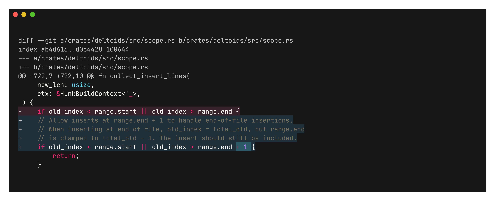
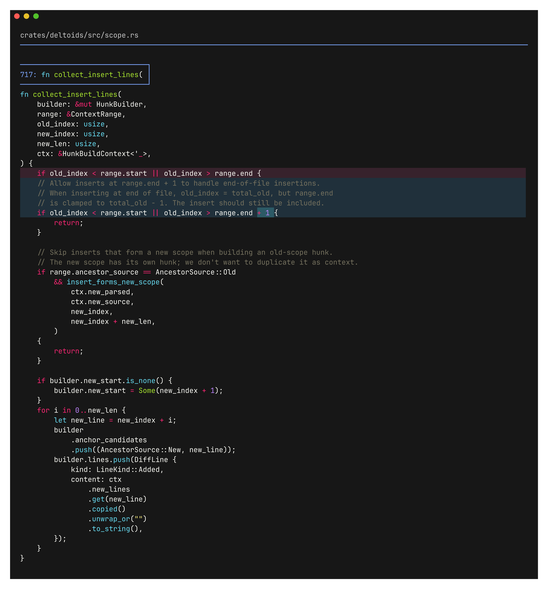

# deltoids

Tools for reviewing code in the agentic era.

<table>
  <tr>
    <td valign="top"></td>
    <td valign="top"></td>
  </tr>
  <tr>
    <td align="center"><em>git diff</em></td>
    <td align="center"><em>deltoids</em></td>
  </tr>
</table>

Hunks expand to show the enclosing function, so you always know where you are.

## Features

- **Syntax highlighting:** spot code changes at a glance.
- **Expanded context:** understand changes within their enclosing scope.
- **Git and GitButler integration:** review file status and manage changes in one place.
- **Commit and branch review:** open any commit, or a whole branch, as one diff.
- **Context on demand:** grow a hunk to its enclosing class or the whole file.
- **Review comments:** copy review notes with file and line references for coding agents.
- **Code navigation:** jump to definitions and callers, and read a symbol's type and docs, through language servers, inside the diff and out.
- **Review guidance:** see which changes need attention first.
- **Responsive TUI:** keep up with changes without unnecessary redraws.
- **Syntax themes:** choose colors that suit your workflow.
- **Custom commands:** use your own tools while reviewing.

## Get Started

Install deltoids:

```bash
brew install juanibiapina/taps/deltoids
```

In a git repository, open the reviewer:

```bash
deltoids tui
```

## Alternative Installation

**Prebuilt binaries (shell installer):**

```bash
curl --proto '=https' --tlsv1.2 -LsSf https://github.com/juanibiapina/deltoids/releases/latest/download/deltoids-cli-installer.sh | sh
```

**From source (cargo):**

```bash
cargo install --git https://github.com/juanibiapina/deltoids deltoids-cli
```

## Use as a pager

Set `deltoids` as git's pager:

```bash
git config --global core.pager 'deltoids | less -R'
```

Or pipe any unified diff through it:

```bash
git diff | deltoids | less -R
```

For lazygit, per-command git pagers, and the GitHub CLI, see the
[pager docs](https://deltoids.dev/docs/integrations/git/).

## Documentation

- [TUI](https://deltoids.dev/docs/tui/): panels, keys, commit and branch
  review, review guidance, code navigation, and comments.
- [Configuration](https://deltoids.dev/docs/configuration/): theme,
  custom commands, and language servers, set in
  `~/.config/deltoids/config.toml`.
